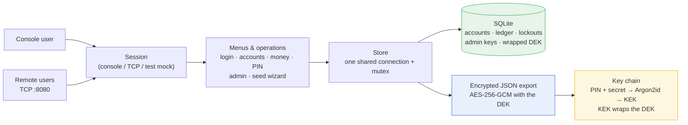

# ATM Rust

A multi-user, threaded console ATM written in Rust. Customers log in
with an account number and PIN, manage several accounts, move money, and see
their history. An admin manages customers, unlocks accounts, rotates
credentials, decrypts the encrypted backup, and can seed batches of random
users. Everything persists in SQLite and is mirrored to an encrypted JSON
snapshot after every change. Several people can use the ATM at the same time
— locally in the console and remotely over TCP.



*users → sessions → menus→ shared store → database and encrypted export, with the key chain that guards
the export. the same map is in plain text in [architecture.md](architecture.md).*

---

## What you can do

- 👤 **Customers:** log in, create/switch/delete accounts, deposit, withdraw,
  transfer to any account number, view the last 10 transactions, change PIN.
- 🔐 **Security:** Argon2id-hashed PINs, three-strikes lockout that survives
  restarts, AES-256-GCM encrypted export, admin PIN **plus** secret key.
- 🛠️ **Admin:** list customers and balances, create customers,
  reset PINs, lock/unlock, delete accounts, view recent transactions, decrypt
  the export, rotate PIN + secret. Choose how many users, then
  set each user's account count and the **exact** money per account. A
  generated name is suggested for each. Nothing is written until you
  re-enter your admin PIN and secret at the final gate. Each user gets a
  random 4-digit PIN, shown once in the closing report. Seeded users work
  exactly like the demo ones — including with several people online at once.
- 🧵 **Concurrency:** one thread per connected user; shared database protected
  by a lock and SQL transactions, so simultaneous withdrawals are safe.

### Demo data

On first run the database is seeded with five hardcoded customers:

| Account | PIN  | Owner  | Balance |
| ------- | ---- | ------ | ------- |
| 10001   | 1234 | Kydas  | 100.00  |
| 10002   | 5678 | Mary   | 250.00  |
| 10003   | 9012 | George | 50.00   |
| 10004   | 3456 | Helen  | 500.00  |
| 10005   | 7890 | Nick   | 0.00    |

The first run also prints a random admin PIN and secret **once** and saves
them in `data/admin.key` (readable only by you, gitignored). Keep them safe —
losing that file makes the encrypted export by the admin practically unreadable!

---

## Run it

```bash
cargo run
```

This starts a console session and a TCP server on `127.0.0.1:8080`. To join
remotely from another terminal:

```bash
ncat 127.0.0.1 8080     # or telnet 127.0.0.1 8080
```

Run the full test suite with:

```bash
cargo test
```

The tests cover accounts and transfers, lockout and admin recovery, credential
rotation and decryption, the seed wizard (including its final gate), and
concurrent access from 2, 3 and 10 clients.

---

## Overview

- SQLite (`data/atm.db`) is the source of truth: balances, transaction history,
lockout state and admin keys all live there. After every change the app
rebuilds a JSON document and writes it **encrypted** to `data/atm_export.json`;
only the admin can decrypt it into `data/atm_export_decrypted.json`
.The encryption uses a random data key (DEK); that key is stored wrapped
by a key derived (with Argon2id) from the admin's PIN and secret. Rotating
credentials  re-wraps only the DEK, never the whole export.

- Money changes run inside SQL transactions: the balance check, the update, and
the ledger entry succeed together or not at all. All user threads share one
store whose database connection is guarded by a mutex, so two people cannot
spend the same money at the same instant.

- Input is validated (positive amounts, 4-digit PINs) and outcomes are clearly
marked `[OK]`, `[ERROR]` and `[INFO]`. Destructive actions ask for a `y/N`
confirmation. Balances use `f64` — but a real bank would use integer cents or something more secure.

---

## Further Reading

- [architecture.md](architecture.md) —  plain-language explanations.
- [details.md](details.md) — encryption, key
  rotation, concurrency and security.

---

>Thank you for your time!

---

## License

Released under the [MIT License](LICENSE).
